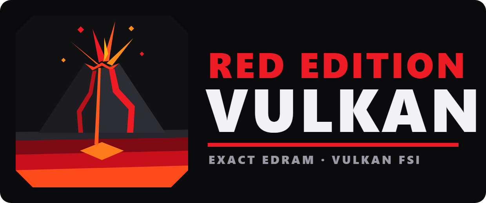

> [!NOTE]
> **This is RED Edition Vulkan**, a research fork of ReXGlue SDK (branch [`rov-research`](https://github.com/crabinacrabic/rexglue-sdk/tree/rov-research)). It makes the exact Xbox 360 EDRAM emulation (the Vulkan fragment shader interlock path) fast enough to play on AMD Radeon: Viva Piñata went from 13–15 to 30 game ticks per second on an RX 6600, with the EDRAM identical to the original shader. Red is for Radeon, the GPU it was tuned on; the volcano and its mantle are for Vulkan, which grew out of AMD's Mantle.
>
> - What changed and how exactness is checked: [docs/accurate-edram-vulkan.md](docs/accurate-edram-vulkan.md).
> - To use it: `render_target_path_vulkan = "fsi"`, `readback_resolve = "lazy"`, `edram_interlock_optimizations = true`. `CommandProcessor::render_target_path()` tells a game whether the exact path really runs (it falls back on GPUs without interlock), and `Presenter::GetPresentStats()` shows how evenly frames reach the screen.
> - Windows builds: [releases](https://github.com/crabinacrabic/rexglue-sdk/releases). The game it was developed with: [Viva Piñata Recomp](https://github.com/crabinacrabic/VivaPinataRecomp) (launcher mode "Accurate").
> - Upstream discussion: [rexglue/rexglue-sdk#520](https://github.com/rexglue/rexglue-sdk/issues/520), the AMD fence bug [rexglue/rexglue-sdk#521](https://github.com/rexglue/rexglue-sdk/issues/521). Tested only on AMD RDNA2 so far; reports from NVIDIA and Intel GPUs are welcome.
>
> A community fork, not affiliated with AMD or the Khronos Group. Vulkan is a registered trademark of the Khronos Group Inc.; Radeon is a trademark of Advanced Micro Devices, Inc. Everything below is the upstream README.

> [!CAUTION]
> This project is in early development. Expect things to not work quite right and there to be significant changes and breaking public API updates as development progresses. Contributions and feedback are welcome, but please be aware that the codebase is still evolving rapidly.

<h1 align="center">
   
  
   
   
  
  
</h1>

ReXGlue converts Xbox 360 PowerPC code into portable C++ that runs natively on modern platforms.

ReXGlue is heavily rooted on the foundations of [Xenia](https://github.com/xenia-project), the Xbox 360 emulator. Rather than interpreting or JIT-compiling PPC instructions at runtime, ReXGlue takes a different path: it generates C++ source code ahead of time, an approach inspired by [XenonRecomp](https://github.com/hedge-dev/XenonRecomp) and [rexdex's recompiler](https://github.com/rexdex/recompiler).

Latest SDK builds and releases are published on [GitHub Releases](https://github.com/rexglue/rexglue-sdk/releases). Join the [Discord server](https://discord.gg/CNTxwSNZfT) for updates and share what you have created.

## Builds

| Channel | CI | Download |
| --- | --- | --- |
| Release |    | [Latest stable](https://github.com/rexglue/rexglue-sdk/releases/latest) |
| Nightly |  | [Latest pre-release](https://github.com/rexglue/rexglue-sdk/releases?q=prerelease%3Atrue) |

## Quickstart

For quick start guide, full CLI reference, and config file options, see the [wiki](https://github.com/rexglue/rexglue-sdk/wiki).

# **Disclaimer**
ReXGlue is not affiliated with nor endorsed by Microsoft or Xbox. It is an independent project created for educational and development purposes. All trademarks and copyrights belong to their respective owners. 

This project is not intended to promote piracy nor unauthorized use of copyrighted material. Any misuse of this software to endorse or enable this type of activity is strictly prohibited.

# Credits

## ReXGlue
- [Tom (crack)](https://github.com/tomcl7) - Project Founder
- [Loreaxe](https://github.com/Loreaxe) - Linux Contributor
- [mystixor](https://github.com/Mystixor) - Windows Contributor
- [Graine25](https://github.com/Graine25) - Project Support
- [Carlos Estrague (mrcmunir)](https://github.com/mrcmunir) - Linux / ARM64 Contributor
- [sanjay900](https://github.com/sanjay900) - Linux / SDL Contributor
- [Toby](https://github.com/TbyDtch) - Project Support
- [Roxxsen](https://github.com/Roxxsen) - CI/CD Contributor

The list above is not exhaustive. Thanks to everyone in the ReXGlue community who contributes code, files issues, tests builds, and keeps the project moving.

## Very Special Thank You:
- [Project Xenia](https://github.com/xenia-project/xenia/tree/master/src/xenia) - Their invaluable work on Xbox 360 emulation laid the groundwork for ReXGlue's development. This project (and numerous others) would not exist without their hard work and dedication.
- [XenonRecomp](https://github.com/hedge-dev/XenonRecomp) - For pioneering the modern static recompilation approach for Xbox 360. A lot of the codegen analysis logic and instruction translations are based on their work. Thank you!
- [rexdex's recompiler](https://github.com/rexdex/recompiler) - The OG static recompiler for Xbox 360. 
- Many others in the Xbox 360 homebrew and modding communities whose work and research have contributed to the collective knowledge that makes projects like this possible.
